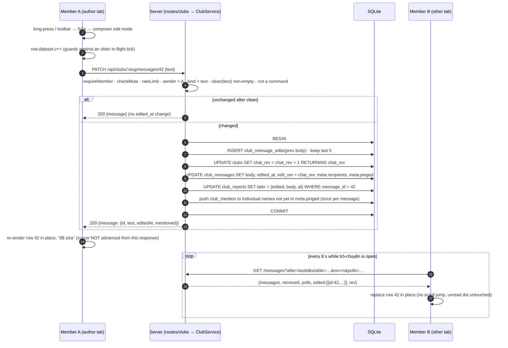
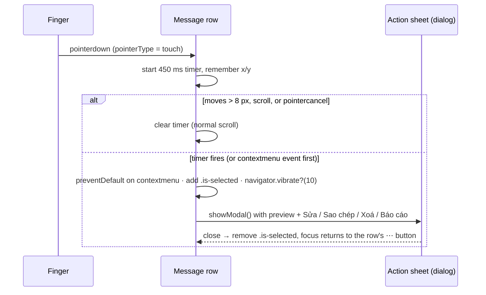

# Sequences
[Stories](../../user_story.md) · [Planning](../../planning.md) · [States](../state.md)

## Edit reaches another open tab (REST polling, no socket)


## Delete (own, or staff by rank) reaches another tab
```mermaid
sequenceDiagram
  autonumber
  participant A as Actor
  participant S as Server
  participant DB as SQLite
  participant B as Other tab
  A->>A: confirm dialog (names the author; staff: "ghi vào nhật-ký")
  A->>S: DELETE /api/clubs/:slug/messages/42
  S->>S: requireMember · sender = actor OR (isStaff AND canModerate(actor, senderRole)) [Q1]
  S->>DB: removeContent → DELETE row (cascades poll/votes/edits) · pin row clears announcement
  S->>DB: UPDATE club_reports SET later = {deleted, at} WHERE message_id = 42
  opt actor ≠ sender
    S->>DB: club_log delete_message
  end
  S-->>A: 200
  A->>A: remove row 42 locally
  B->>S: GET /messages?after=…&visible=…,42,…
  S-->>B: {removed:[42], …}
  B->>B: remove row 42 · rebuild day separators
```

## Phone long-press vs scroll

