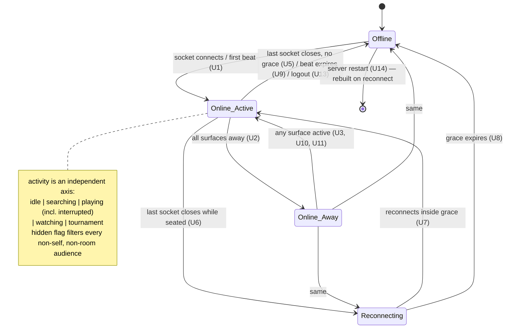
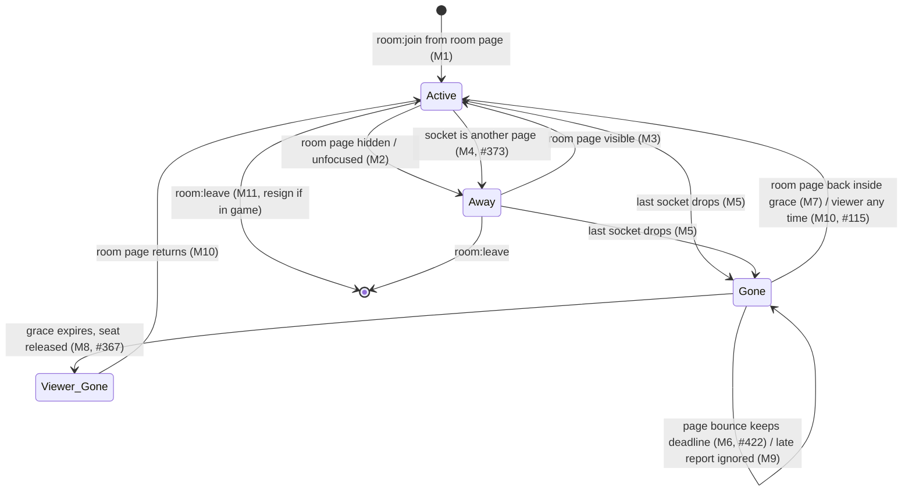
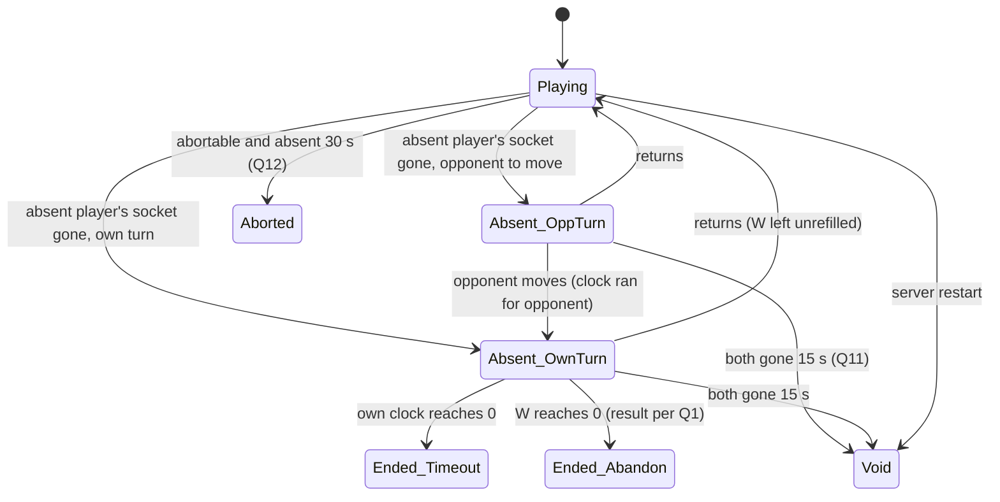
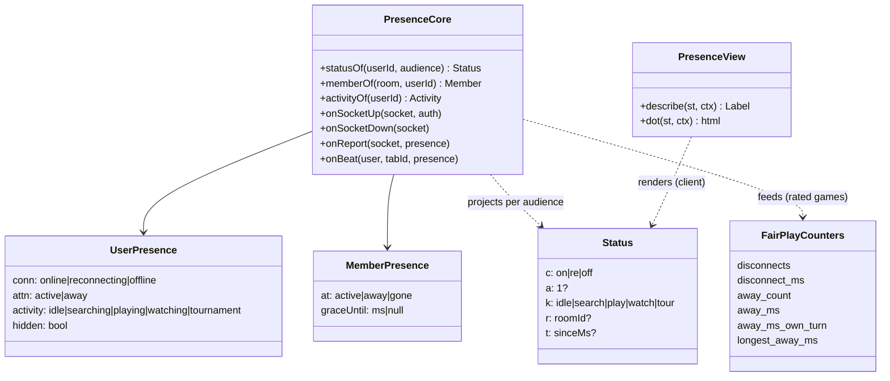

# presence-status — state and class diagrams

Back: [planning.md](../planning.md) · [user_story.md](../user_story.md) · [sequences](uml_diagram/sequences.md).
Row ids (U*, M*) refer to the transition tables in planning.md §2e/§2f.

## User scope (per account)

## Room-member scope (per room user, wire field `presence`)

## Rated game absence (proposal, Q1/Q2 recommended options)

## Class view (target)

