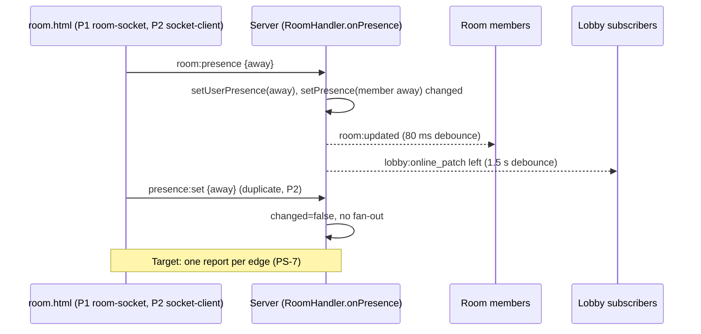
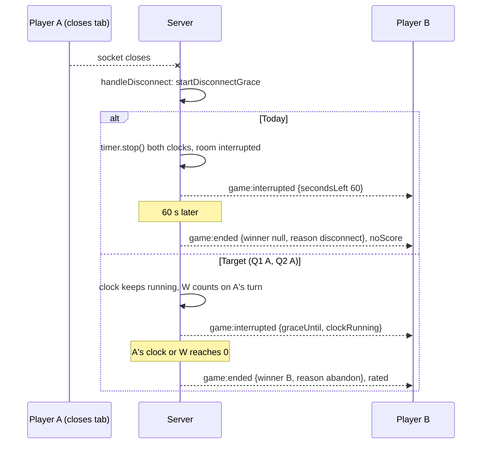
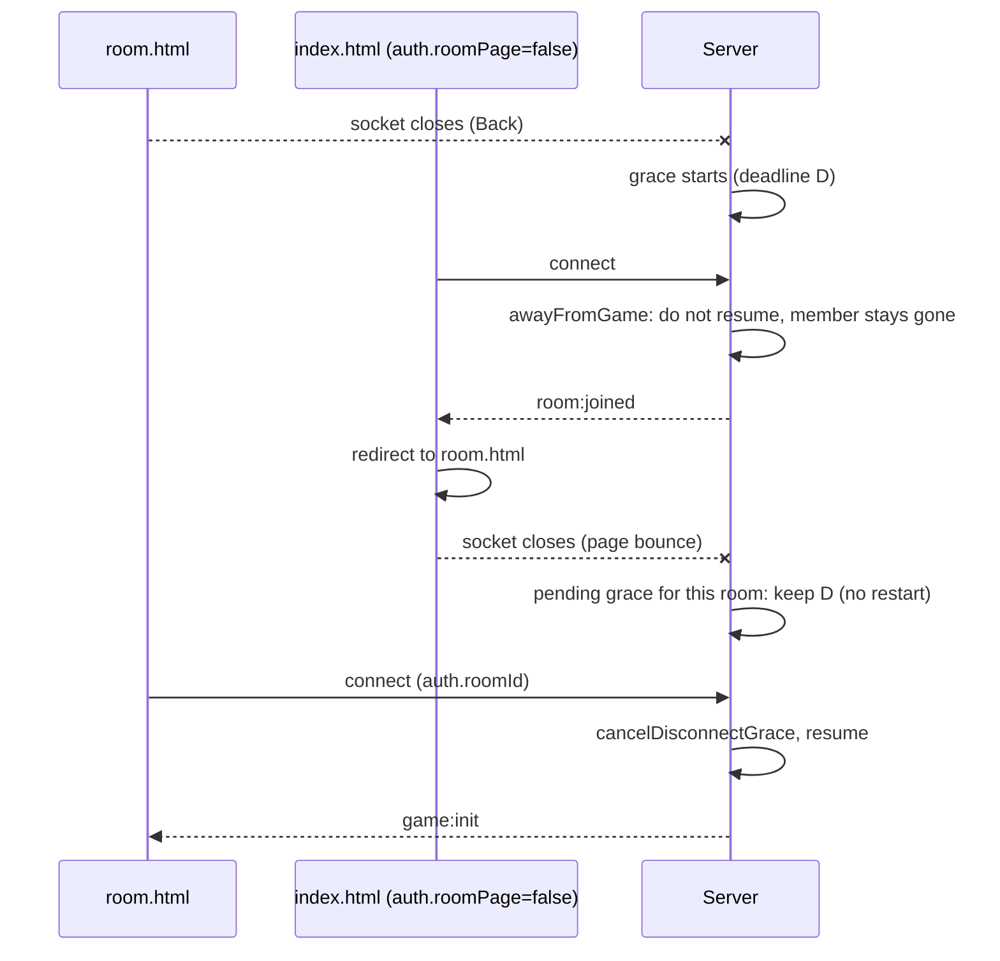
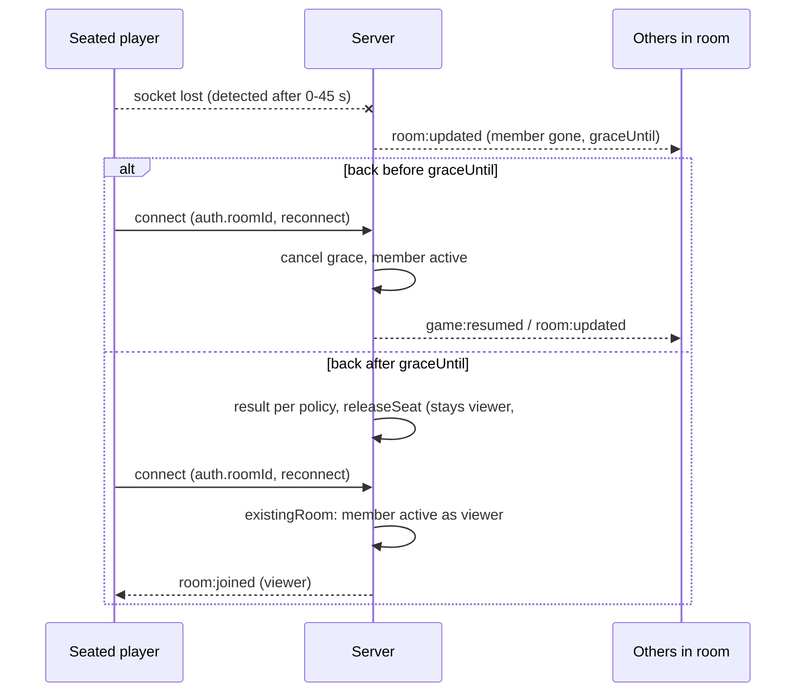
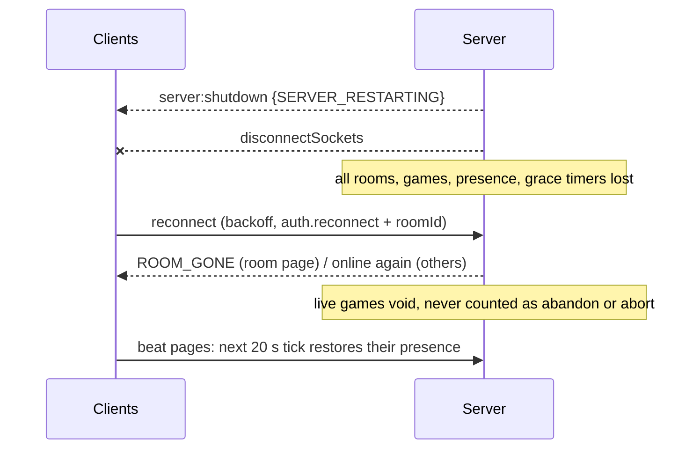
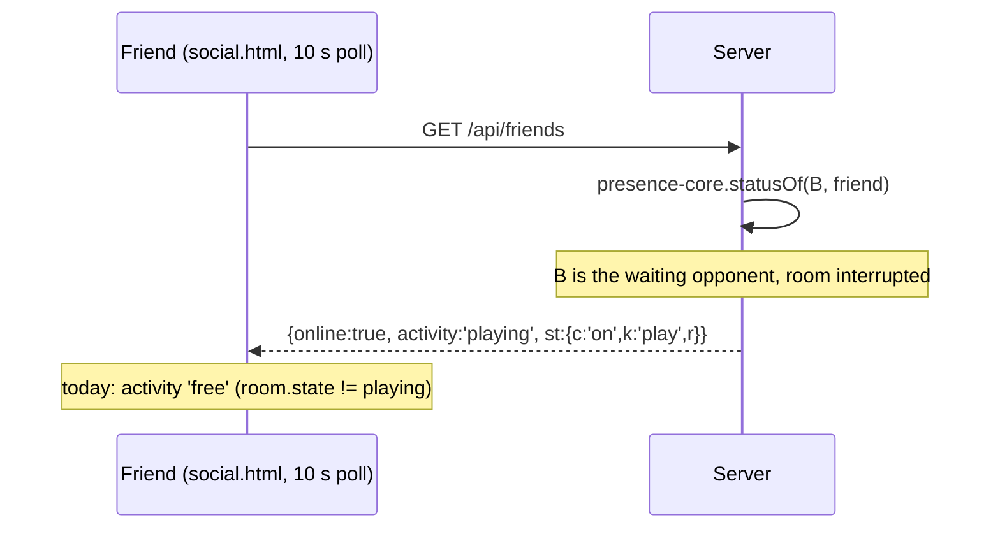

# presence-status — sequences

Back: [planning.md](../../planning.md) · [state + class](../state-model.md) · [user_story.md](../../user_story.md).
"Today" = current code on `dev` @ c1a2c3af; "Target" = the recommended options in planning.md §6.

## 1. Tab switch on the room page (today: double report, F1)

## 2. Tab close in a rated game (today vs target)

## 3. Back mid-game (#422, kept)

## 4. Reconnect inside vs outside the grace

## 5. Server restart

## 6. Friend views a player in an interrupted game (problem 3, target)

