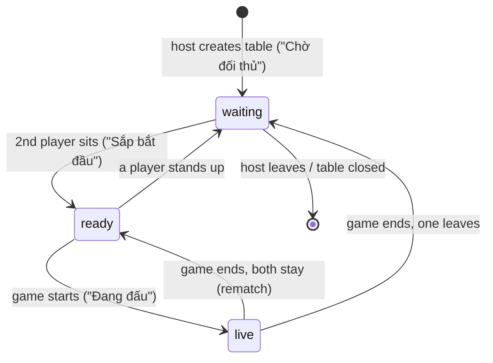
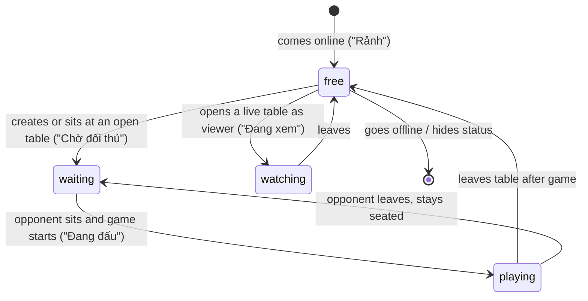
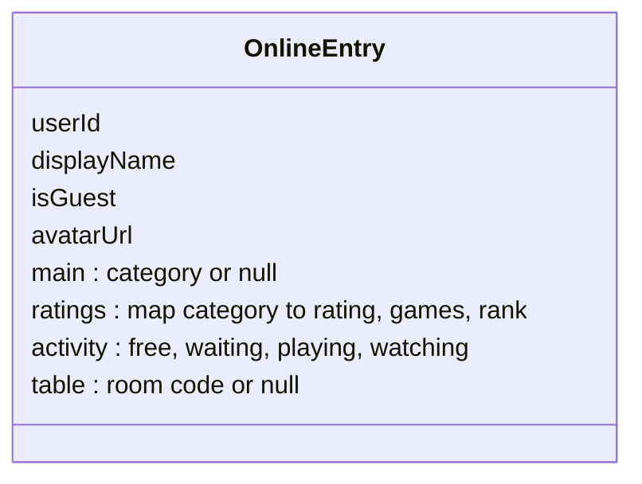

# Table state and player activity

Links: [../planning.md](../planning.md) · [../user_story.md](../user_story.md) · [uml_diagram/lobby-roster-sequence.md](uml_diagram/lobby-roster-sequence.md)

Table state as the lobby shows it (label + dot, never colour alone):

Player activity on the roster (derived server-side, backend item B2):

Roster entry shape (proposal, backend item B):

