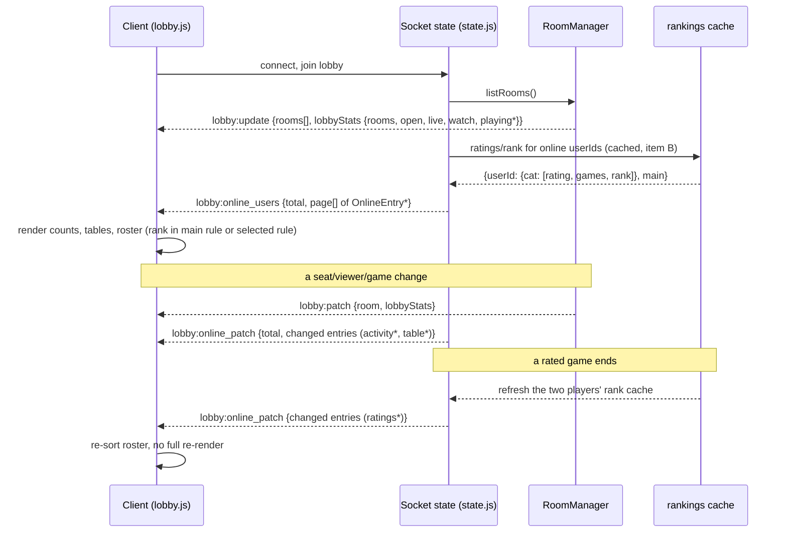

# Lobby join → online snapshot/patch → roster render

Links: [../../planning.md](../../planning.md) · [../../user_story.md](../../user_story.md) · [../table-player-states.md](../table-player-states.md)

`*` = field not sent today (planning.md items A/B/B2). `moves`/`startedAt` for the mini board are already in `lobbyEntry` (#364).
