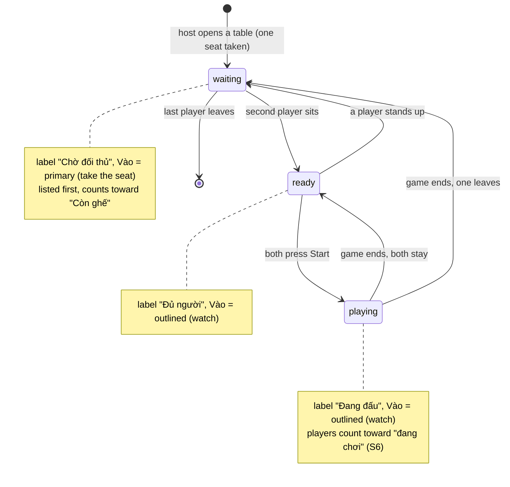
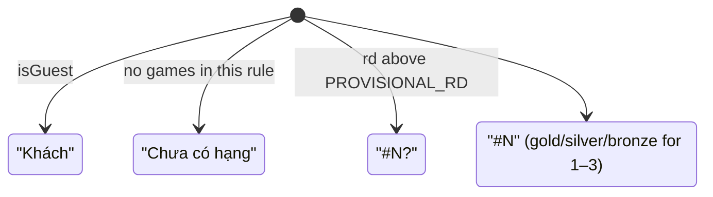

# Table states and the "Vào" button (v4)

Links: [../planning.md](../planning.md) · [../user_story.md](../user_story.md) · [uml_diagram/rule-rank-sequence.md](uml_diagram/rule-rank-sequence.md)

Rank chip of a seated player (per selected rule):

