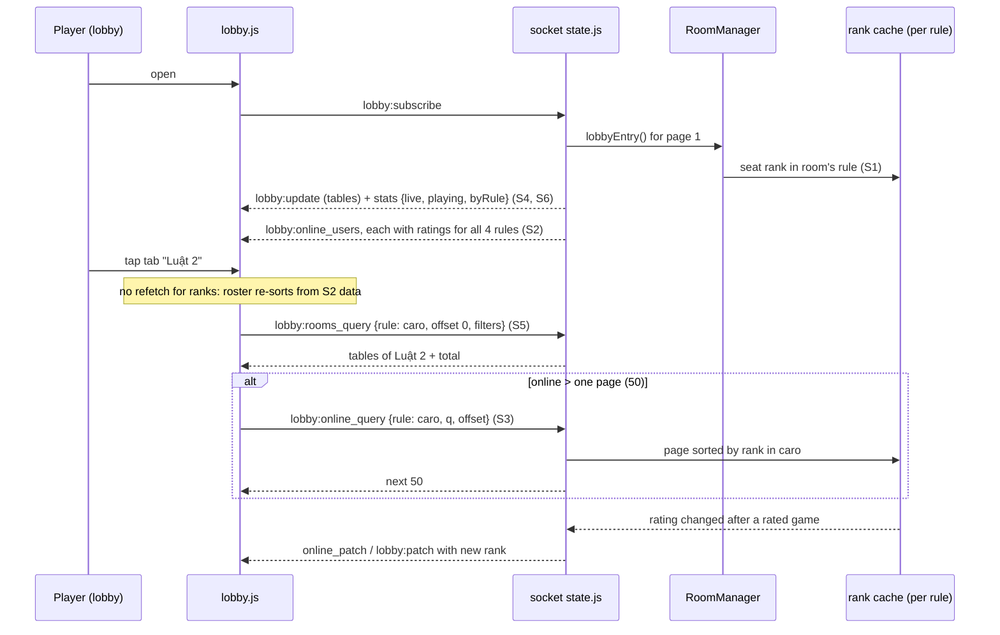

# Selecting a rule tab: where the ranks come from (target, after backend S1–S5)

Links: [../../planning.md](../../planning.md) · [../../user_story.md](../../user_story.md) · [../table-states.md](../table-states.md)

